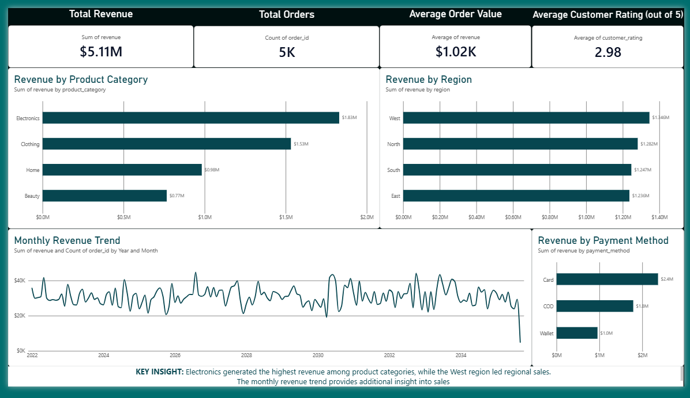

### E-Commerce Sales Performance Analysis

#### Project Overview

This project analyzes **5,000 e-commerce orders** to evaluate sales performance, product categories, regional revenue, customer ratings, and monthly revenue trends.

I used Python and Pandas for data cleaning and analysis, then created an interactive dashboard using Power BI.

#### Business Objectives

- Evaluate overall sales performance.
- Compare revenue across product categories and regions.
- Examine monthly revenue trends.
- Review customer ratings and delivery performance.
- Communicate findings through an interactive dashboard.

#### Tools and Technologies

- **Python:** Data cleaning and analysis
- **Pandas:** Data manipulation and aggregation
- **Jupyter Notebook:** Data analysis and documentation
- **Power BI Desktop:** Dashboard development
- **GitHub:** Project documentation and portfolio hosting

#### Project Structure

- `data/` — Cleaned e-commerce dataset
- `notebooks/` — Jupyter notebook containing Python analysis
- `dashboards/` — Power BI report and dashboard screenshot

#### Dashboard Preview

The dashboard presents key performance indicators and visualizations covering product categories, regional revenue, and monthly revenue trends.

#### Key Findings

- **Total Revenue:** $5.11 million
- **Total Orders:** 5,000
- **Top Revenue-Generating Category:** Electronics
- **Highest-Revenue Region:** West
- **Average Customer Rating:** Approximately 2.98 out of 5

**Note:** Revenue does not represent profit because product costs and operating expenses were not included in the dataset.

#### How to Explore the Project

1. View the dashboard screenshot above.
2. Open the Jupyter notebook to review the data-cleaning and analysis process.
3. Download the Power BI `.pbix` file from the `dashboards/` folder.
4. Open the file in Power BI Desktop to explore the report interactively.

#### Use of Generative AI

Generative AI assisted with code development, debugging, documentation, and analytical brainstorming. Code and analytical results were reviewed, tested, and validated before inclusion.
